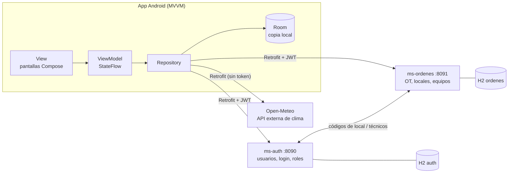

# ACIS OT Terreno

App Android para gestionar **órdenes de trabajo (OT) en terreno** de ACIS Servicios Técnicos Ltda., empresa de mantenimiento de climatización y refrigeración comercial. El jefe crea y asigna las OT, el técnico las atiende en el local (check-in con GPS, diagnóstico y foto de evidencia), el jefe da conformidad y el cliente sigue el avance.

| | |
|---|---|
| **Integrante** | Luis Roa Riquelme (proyecto individual) |
| **Asignatura** | DSY1105 Desarrollo de Aplicaciones Móviles, Duoc UC |
| **Evaluación** | Evaluación Final Transversal (EFT): encargo + defensa técnica |
| **App móvil** | Kotlin, Jetpack Compose, Material 3, MVVM, Room, Retrofit |
| **Backend** | 2 microservicios Spring Boot 4 (Java 25) con base de datos H2 |

## Arquitectura



- **Almacenamiento externo (microservicios):** es la fuente de la verdad. Lo comparten todos los roles: el jefe, el técnico y el cliente ven la misma OT desde teléfonos distintos.
- **Almacenamiento local (Room):** guarda una **copia** de lo último que entregó el servidor. Así el técnico sigue viendo sus OT sin señal (azoteas, subterráneos). Las acciones necesitan conexión, porque el servidor valida las reglas.
- **Seguridad:** el login entrega un **token JWT** firmado con el rol del usuario. Cada microservicio verifica la firma y **filtra con los datos del token**, nunca con lo que mande la app.

## Funcionalidades por rol (4 roles)

| Rol | Qué hace |
|---|---|
| **Administrador** | Aprueba o rechaza clientes que se registran, crea técnicos, jefes y otros admins, y desactiva cuentas. Ve todas las OT. |
| **Jefe de mantenimiento** | Crea, edita, asigna, posterga y cancela OT. Revisa la evidencia y da **conformidad** o **disconformidad**. Administra locales y equipos. Exporta el informe de la OT. |
| **Técnico** | Ve sus OT del día y la próxima visita. Acepta o rechaza. Hace **check-in con GPS**, registra el diagnóstico con **foto** y cierra. Ve el **clima del local** antes de subir a una azotea. |
| **Cliente** | Se registra con el **código de su local** y queda pendiente hasta que el admin lo apruebe. Solo consulta el avance de las OT de su local y exporta el informe. |

**Para todos:** inicio de sesión, **registro**, **recuperar contraseña** (código de 6 dígitos que vence en 10 minutos, con 5 intentos) y **editar perfil**. Cada OT tiene un **historial** con quién hizo cada cambio y cuándo.

## Requisitos de la pauta y dónde están

| Requisito | Dónde está |
|---|---|
| Formularios validados con íconos y mensajes | `util/Validaciones.kt` (lógica separada de la UI) y `view/components/CampoValidado.kt`. El backend vuelve a validar con `@Valid` |
| Animaciones | `view/components/Animaciones.kt`, transiciones de navegación, lista animada, `AnimatedContent` en recuperar contraseña |
| MVVM y persistencia local | `viewmodel/`, `repository/`, `data/` (Room con 5 tablas) |
| 2 recursos nativos | **GPS** (check-in) y **cámara** (foto de evidencia), con permisos en tiempo de ejecución |
| Microservicios propios con BD y CRUD | `backend/ms-auth` y `backend/ms-ordenes` (Spring Boot + H2) |
| API externa con Retrofit | Open-Meteo: `data/remote/ClimaApi.kt`, tarjeta "Clima en el local" en el detalle de la OT |
| Pruebas ≥ 80 % de la lógica | 117 pruebas unitarias con **MockK**, cobertura **97 %** medida con **Kover** |
| APK firmado | `apk/ACIS_OT_Terreno-v1.0-release.apk`, llave en `keystore/` |
| POO: herencia y polimorfismo | `AcisException` y sus subclases (backend), `EnviadorCorreo` → consola o Gmail, `FuenteUbicacion` → GPS real o falso, `sealed class Resultado` |
| Manejo de excepciones | `data/remote/Resultado.kt`: `try-catch` de `IOException` (sin red) y `HttpException` (error del servidor), con mensaje claro en pantalla |

## Endpoints

### Propios: ms-auth (`http://localhost:8090`)

| Método | Ruta | Quién | Para qué |
|---|---|---|---|
| POST | `/auth/login` | Público | Login. Devuelve el token JWT, que dura 8 h |
| POST | `/auth/registro` | Público | Registro de cliente con código de local; queda PENDIENTE |
| POST | `/auth/recuperar` | Público | Envía el código de 6 dígitos. La respuesta es siempre la misma |
| POST | `/auth/restablecer` | Público | Código + contraseña nueva |
| GET / PUT | `/usuarios/yo` | Con sesión | Ver y editar el perfil propio |
| GET | `/usuarios/tecnicos` | Jefe, Admin | Técnicos activos, para asignar OT |
| GET / POST | `/admin/usuarios` | Admin | Listar (filtro `?estado=PENDIENTE`) y crear usuarios |
| GET / PUT / DELETE | `/admin/usuarios/{id}` | Admin | Ver, editar, y eliminar: rechaza a un pendiente o desactiva a un usuario |
| PUT | `/admin/usuarios/{id}/aprobar` | Admin | Aprobar a un cliente pendiente |

### Propios: ms-ordenes (`http://localhost:8091`)

| Método | Ruta | Quién | Para qué |
|---|---|---|---|
| GET | `/ordenes` | Con sesión | OT según el rol: todas (jefe y admin), las asignadas (técnico) o las de su local (cliente) |
| GET | `/ordenes/{id}` y `/ordenes/{id}/historial` | Con sesión | Detalle e historial (404 si no le corresponde) |
| POST / PUT | `/ordenes`, `/ordenes/{id}` | Jefe | Crear y editar, asignar o reprogramar |
| DELETE | `/ordenes/{id}` | Jefe | Solo una OT recién creada; las demás se cancelan |
| POST | `/ordenes/{id}/acciones` | Según la máquina de estados | Aceptar, rechazar, visita fallida, conformidad, disconformidad, postergar, cancelar |
| POST | `/ordenes/{id}/check-in` y `/ordenes/{id}/cierre` | Técnico asignado | Check-in con coordenadas; cierre con diagnóstico y foto |
| GET / POST / PUT / DELETE | `/locales`, `/locales/{id}`, `/locales/{id}/equipos` | Jefe, Admin | CRUD de locales |
| GET / POST / PUT / DELETE | `/equipos`, `/equipos/{id}` | Jefe, Admin | CRUD de equipos: si tiene historial se da de baja; si tiene una OT en curso, 409 |
| GET | `/locales/codigo/{codigo}` | Público | Valida el código del local en el registro (solo id y nombre) |
| GET | `/locales/mio` | Cliente | Su local |

Errores: siempre en JSON `{"status": 409, "error": "mensaje"}`. Los códigos son 400 (dato inválido), 401 (sin sesión o clave mala), 403 (rol o cuenta no permitida), 404, 409 (regla de negocio) y 503 (otro servicio no responde).

### Externo: Open-Meteo

`GET https://api.open-meteo.com/v1/forecast?latitude=..&longitude=..&current=temperature_2m,precipitation,weather_code,wind_speed_10m&timezone=auto`

Es gratis y no pide clave. Usa su propio cliente Retrofit, **sin** el token de ACIS, y no se guarda en Room. Si llueve o hay viento fuerte y el equipo está en la azotea, la app recomienda postergar.

## Probar la app en un celular (backend en internet)

Los dos microservicios están publicados en **Render** (plan gratuito), así que el APK funciona en cualquier celular Android con internet, sin encender nada:

- ms-auth: `https://acis-ot-auth.onrender.com`
- ms-ordenes: `https://acis-ot-ordenes.onrender.com`

1. Descargar el APK: [ACIS_OT_Terreno-v1.0-release.apk](https://github.com/Luis-svg-ops/Desarrollo-de-Aplicaciones-M-viles-Ev-2/raw/main/apk/ACIS_OT_Terreno-v1.0-release.apk).
2. Instalarlo (Android pide permitir "instalar apps de origen desconocido").
3. Entrar con un usuario de prueba (más abajo).

> El plan gratuito "se duerme" si nadie lo usa: **la primera conexión puede tardar hasta 1 minuto**. Después responde normal. Al reiniciarse, los datos vuelven a los de ejemplo.

En el login, **⚙ Servidor** permite cambiar a dónde se conecta la app: *En internet* (por defecto), *PC local* (emulador con el backend en el PC, `10.0.2.2`) u *Otra dirección* (por ejemplo un túnel https). La publicación se define en `render.yaml` y en el `Dockerfile` de cada microservicio.

## Cómo ejecutar

Requisitos: **Java 25** (para el backend) y **Android Studio** con un emulador Android 8.0 (API 26) o superior.

**1. Backend** (dos terminales, una por microservicio):

```
cd backend/ms-auth
./mvnw spring-boot:run          # Windows: .\mvnw.cmd spring-boot:run
```
```
cd backend/ms-ordenes
./mvnw spring-boot:run          # Windows: .\mvnw.cmd spring-boot:run
```

Cuando aparece `Started MsAuthApplication` y `Started MsOrdenesApplication`, ya están listos. La base H2 se crea sola en `backend/*/data/`, con datos de ejemplo. El correo de recuperar contraseña se escribe en la consola de ms-auth ("CORREO (simulado)"); para enviarlo de verdad por Gmail: `CORREO_MODO=gmail`, `GMAIL_USUARIO` y `GMAIL_CLAVE_APP`.

**2. App:** abrir la carpeta `ACIS_OT_Terreno` en Android Studio, esperar la sincronización de Gradle y presionar **Run**. Para usar el backend del PC, en el login tocar **⚙ Servidor → PC local (emulador)** (el emulador llega al PC con `10.0.2.2`).

**Pruebas:**

```
./gradlew testDebugUnitTest            # 117 pruebas unitarias (MockK)
./gradlew koverHtmlReportDebug         # cobertura → app/build/reports/kover/htmlDebug/index.html
./gradlew connectedDebugAndroidTest    # 54 pruebas en el emulador (Room real)
cd backend/ms-auth && ./mvnw test      # 26 pruebas del microservicio de usuarios
cd backend/ms-ordenes && ./mvnw test   # 15 pruebas del microservicio de OT
```

## Usuarios de prueba (contraseña `123456`)

| Rol | Correo |
|---|---|
| Administrador | admin@acis.cl |
| Jefe de mantenimiento | jefe@acis.cl |
| Técnico | tecnico@acis.cl (Pedro Soto) |
| Cliente (Mall Costanera Oeste) | cliente@acis.cl |
| Cliente pendiente de aprobación | jdiaz@acis.cl |

Códigos de local para registrarse: `MAIPU-01`, `MALL-02`, `PROV-03`.

## APK firmado

- **APK:** `apk/ACIS_OT_Terreno-v1.0-release.apk`, versión 1.1 (2,3 MB). Es release, firmado y optimizado con R8.
- **Llave:** `keystore/acis-release.jks` (alias `acis`, RSA 2048, válida 10.000 días).
- **Configuración:** `keystore/keystore.properties` y `signingConfigs` en `app/build.gradle.kts`. Las variables de entorno `ACIS_STORE_PASSWORD` y `ACIS_KEY_PASSWORD` tienen prioridad sobre el archivo.
- **Regenerarlo:** `./gradlew assembleRelease`, que deja el resultado en `app/build/outputs/apk/release/app-release.apk`.
- **Comprobar la firma:** `apksigner verify --print-certs apk/ACIS_OT_Terreno-v1.0-release.apk`.

> La pauta pide dejar el `.jks` y su configuración en el repositorio. En una app real **nunca** se suben: si alguien obtiene la llave, puede publicar versiones falsas de la app. Por eso el build lee primero las variables de entorno.

## Estructura

```
ACIS_OT_Terreno/
├── app/src/main/java/cl/duoc/acis/
│   ├── model/        entidades de Room, roles, estados y la máquina de estados de la OT
│   ├── data/         Room (AppDatabase, DAOs)
│   │   └── remote/   Retrofit: APIs, DTOs, traductores, manejo de errores (Resultado)
│   ├── repository/   única puerta a los datos: servidor + copia en Room
│   ├── viewmodel/    lógica y estado de cada pantalla
│   ├── navigation/   rutas (sealed class) y barra inferior según el rol
│   ├── view/         pantallas Compose y componentes reutilizables
│   └── util/         validaciones, fechas, clima, GPS, fotos, informe JSON
├── app/src/test/        pruebas unitarias (JUnit + MockK)
├── app/src/androidTest/ pruebas en el emulador
├── backend/
│   ├── ms-auth/      Spring Boot: controller → service → repository → model
│   └── ms-ordenes/   Spring Boot: controller → service → repository → model
├── apk/              APK firmado
└── keystore/         llave de firma y su configuración
```

## Trabajo y planificación

- **GitHub:** una rama por funcionalidad (`feature/...`), unida a `main` con `--no-ff`, así que el historial muestra cada etapa del proyecto.
- **Requerimientos:** planilla Scrum con historias de usuario, criterios de aceptación (Dado / Cuando / Entonces) y una hoja de trazabilidad que indica qué prueba cubre cada escenario.
